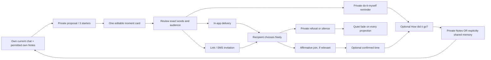

# Lane P: Connection moments

26 October 2026. Spec for Astro and Debug to review. No implementation or release approval is implied. This spec is the report requested by `lane-p-connection-moment-spec.md`.

## 1. The decision and its boundaries

Astro, verbatim at 10:55:

> "Dont make this limited to just planning an occasion, it could be anything beyond that helps build connections and relationships based on context and past notes"

Build one **ConnectionMoment**: an optional step toward someone, with the person's own words, optional time and place, and an optional memory afterward. Time together is one kind. Check-ins, follow-ups, care, celebration, repair, sharing a memory/photo, saying "I miss you", and being there are equal kinds. A moment can be sent in the app, shared as an invitation by link/SMS, or kept as "I'll do it myself". AI only proposes; the person chooses, edits, and sends.

The entire 10:45 note and its 10:55 addendum were read. The supplied `Logs/design-mocks/2026-10-26/plan-together/plan-together-board.png` was viewed. Keep its before/during/their-side/after journey, the shared choice-card grammar, the sender's words, quiet fading, and circle plans proceeding with whoever joins. Generalize its event-only examples. The board is not approval of new non-event, guest, privacy, or error screens. Flow review, then mock review, must precede any app or server implementation for those surfaces.

**Recommended approach:** add a ConnectionMoment aggregate and an optional, unique link to an existing PlaceInvite for eligible two-person, place-based time together. Keep working place behavior. Do not rename PlaceInvite, make its required fields meaningless, or generate one pairwise invite per circle member.

| Approach | Benefit | Cost / decision |
| --- | --- | --- |
| ConnectionMoment with a narrow PlaceInvite adapter | One journey for every kind; preserves working place contracts | Recommended. Must make field ownership and push deduplication explicit. |
| Extend PlaceInvite into every kind | Reuses one table | Reject. Required placeName and sender/receiver shape do not describe a private reminder or a circle [E1]. Weakening them exposes existing clients to invalid objects. |
| Separate object per kind | Each kind is easy to name | Reject. Repeats sending, expiry, privacy, reminders, and completion logic nine times. |

No separate Plans tab, booking, venue/deal search, attendance scores, relationship score, read receipts, automatic sending, automatic calendar scan, or location tracking. No new paywall on receiving, responding, privacy, or deletion. Those are proposed scope boundaries, not claims about today's entitlement code.

## 2. Evidence and confidence

Paths below are relative to these exact read-only research roots:

- **A:** `/Users/astro/Projects/murror-transfer/Murror/MurrorMobile-worktrees/notes-n-app`, HEAD `72dc43b9f6da0bc679e011c306d8229c79331d46`.
- **S:** `/Users/astro/Projects/murror-transfer/Murror/murror-api-worktrees/notes-n-server`, HEAD `8f26a2d962d0e7adaa53303159ac4840cd883761`.
- **V:** `/Users/astro/Projects/murror-transfer/Murror/viasr-api-worktrees/reply-options`, HEAD `63b9439bafcddf51c0e89b9f7ef95c90de3e7fb0`.

Every existing-code assertion is tied to an evidence row with file:line and checked/not checked. **Checked means read in local source, not executed or deployed.** Everything described as a requirement, proposal, target, or future phase below remains unimplemented by this lane. Proposed paths are ownership targets, not claims that a file exists.

| ID | Existing code finding and source | Status |
| --- | --- | --- |
| E1 | PlaceInvite requires placeName, senderId, receiverId and a connection; carries planned/agreed local time, timezone and UTC, counters, per-person reminder claims, wentAt, version and unique chatPlaceIdeaId. `S/prisma/schema.murror.prisma:1927`, `:1936`, `:1939`, `:1948`, `:1963`, `:1966`, `:1990`. This is the relevant schema, not legacy `schema.prisma`. | checked |
| E2 | Authenticated planned-time PUT, `/went` POST, why-line POST, and `/v1/place-plans` Calendar GET exist. `S/src/modules/connection/presentation/controllers/place-plans.controller.ts:29`, `:36`, `:53`, `:65`, `:83`, `:89`. | checked |
| E3 | markWent resolves the connection, authorizes either of the two participants, requires accepted/agreed/past time, returns existing wentAt idempotently, and increments the version on write. `S/src/connections/services/place-plans.service.ts:533`, `:560`, `:583`, `:585`, `:593`. It does not establish who attended a circle. | checked |
| E4 | Reminder minute job selects accepted, agreed, future plans due within two hours; requires both people active within seven days; rechecks safety/quiet hours; claims per-person sends; calls OneSignal with PlacePlanReminder. `S/src/connections/services/place-plan-reminder.service.ts:60`, `:73`, `:113`, `:146`, `:184`, `:201`, `:242`. This inspected send path does not call Care's budget. | checked |
| E5 | Place expiry is an hourly cluster-locked PENDING-only soft expiry, using 14 days and respecting a proposed future day; no push/broadcast by design. `S/src/connections/services/place-invite-expiry.service.ts:13`, `:25`, `:32`, `:46`, `:63`, `:81`. | checked |
| E6 | Calendar mapping rejects non-accepted, went, missing-name and nonfuture invites, emits a one-hour event and connection deep link. Native Calendar is iOS/bridge-dependent and called by an explicit action. `A/src/services/care-native-plan.ts:16`, `:20`, `:24`, `:39`, `:50`. | checked |
| E7 | Optional native plan Live Activity start/end methods already exist, serialized with account-cleanup generation protection; not proof of automatic day-of scheduling. `A/src/services/moment-live-activity.ts:34`, `:60`, `:83`, `:103`. | checked |
| E8 | Home place invite projection has time-based visibility/retirement and stable place-specific card keys and location data. `A/src/utils/feed/build-place-suggestion-invite-cards.ts:28`, `:62`, `:75`, `:89`, `:124`. General moments cannot simply be inserted as places. | checked |
| E9 | Native Care category registers an authenticated text reply and forwards unrelated actions to its previous delegate. `A/ios/MurrorMobile/CareNotificationHandler.swift:60`, `:72`, `:95`. This handler is not the requested two-button moment response. | checked |
| E10 | OneSignal JS click listener checks account ownership, queues notification navigation, and handles settings separately. `A/src/config/one-signal.ts:98`, `:104`, `:109`, `:127`. | checked |
| E11 | Care cap is zero for off or quietDays < 1, otherwise activity/preference-dependent, at most three/day. Slots are local 08:30, 12:30, 19:00 as eligible. `S/src/care/application/care-policy.ts:28`, `:37`, `:50`, `:63`. Do not assume a single constant daily cap. | checked |
| E12 | Shared Care budget counts CLAIMED/SENT care, daily-note and streak reservations; rarely also has a two/week limit. `S/src/care/infrastructure/care-push-budget.ts:34`, `:40`, `:43`, `:64`, `:91`. | checked |
| E13 | Care delivery revalidates preferences, processing consent for AI words, quiet hours, crisis quiet, privacy token, opens and capacity. `S/src/care/application/care-push.service.ts:70`, `:92`, `:103`, `:132`, `:139`, `:149`. Per-user lock and reservation check: `S/src/care/infrastructure/care-planner.repository.ts:39`. | checked |
| E14 | Conductor has place/song/movie/quota/rest action kinds and one-action admission with fixed-safety fallback. `V/app/services/deep_chat_stream/application/conductor.py:61`, `:106`, `:113`, `:183`, `:248`. No moment kind in these inspected branches. | checked |
| E15 | stream_chat receives memory_context and autonomous_notes; caps injected memory prose and instructs against invented specifics. This does not prove source-by-source ownership of an arbitrary context string. `V/app/services/deep_chat_stream/application/use_cases/stream_chat.py:737`, `:747`, `:757`, `:1033`, `:1043`, `:1059`. | checked |
| E16 | Owned Notes reader checks live owner, storage permission, privacy epoch and revision; stale suggested rows disappear, retained contributions can remain. Its comment explicitly says no model context. `S/src/conversation-notes/application/read-owned-notes.use-case.ts:64`, `:80`, `:83`, `:91`, `:117`, `:133`. Do not treat this display reader as an AI-context permission grant. | checked |
| E17 | Memory Room has authenticated, capability-gated plan-line list/put/delete and connection-note CRUD. `S/src/modules/memory/presentation/controllers/memory-plan-lines.controller.ts:22`, `:30`, `:40`, `:51`, `:63`; `S/src/modules/memory/presentation/controllers/memory-connection-notes.controller.ts:23`, `:30`, `:42`. Their storage/visibility implementations were not traced. | checked routes; underlying semantics not checked |
| E18 | Place time helpers derive timezone from venue coordinates, reject ambiguous DST times and past times, and apply a one-hour lead to new suggestions. `S/src/connections/domain/place-plan-time.ts:24`, `:78`, `:111`, `:133`. No-place moments need an explicit timezone path. | checked |
| E19 | Stored venue suggestions check whether a place repeats a live plan; this check deliberately fails open on read failure. `S/src/connections/application/use-cases/place-suggestion/get-place-suggestion.use-case.ts:809`, `:825`, `:835`. This is a duplicate-venue check, not proof that a venue is open. | checked |
| E20 | Legacy next-step parser handles goal/replies and rejects other kinds at this boundary. `A/src/apis/client/chat-next-step-contract.ts:68`, `:73`, `:87`. Other parsers/stream consumers still need a full implementation blast-radius audit. | checked boundary; other consumers not checked |
| E21 | Generalized moment widgets, guest invitation web flow, circle moment row storage and actionable moment category are not verified. Reference anchors for adjacent code only: `A/src/services/moment-live-activity.ts:34`, `A/ios/MurrorMobile/CareNotificationHandler.swift:72`, `S/prisma/schema.murror.prisma:1927`. Do not infer repository-wide absence from these anchors. | not checked |

**Graph use:** read `~/graphify-shared/LAST-REFRESH.txt`: 26 Oct 09:58:06. Ran `graphify explain PlacePlansService`, `explain PlacePlanReminderService`, `explain carePlanFromInvite`, and `affected PlacePlansService --depth 2` against `~/graphify-shared/merged-graph.json`. Findings about those symbols were checked against source above. `affected PlaceInvite` matched an app test helper named placeInvite, not the Prisma model; discarded that result. `explain ConductorAction` and `CarePushSchedulerService` returned no node. Schema and private Python functions therefore required targeted source search. No graph edge is treated as proof of runtime behavior.

At 11:44 PDT the snapshot was under two hours old. Local remote refs were two commits beyond the graph for mobile and server, zero for viasr. Network freshness was not checked: no fetch in this read-only lane. Research roots were inspected as supplied; they are not proof of the deployed tree. The requested `Murror/docs/CODEX-HANDOFF.md` was absent; no substitute was silently treated as that handoff. No production records, message content, databases or external systems were queried.

## 3. Visual journey and surface map

One card per moment ID. AI Chat uses the action-card slot; Home uses one existing rail slot; Between us uses the relevant upcoming/care slot; the circle weekly card uses its plan slot. Proposed priority in a competing slot: fixed safety first, an active confirmed moment next, an explicit unfinished draft next, then a contextual proposal, then a fixed starter. A replaced idea returns only if still relevant. Arrival Live Activities are not ended merely to show a plan. No duplicate card for the PlaceInvite adapter, no duplicate success toast, no Home badge counting people.

### Actors and labels

**P** person/sender; **R** other person in the app; **G** other person outside the app via link/SMS; **C** circle member; **AI** Murror AI; **O** Debug/ops. P also includes a new person with no history or connections. C includes joined, quiet, and lapsed members. Blocked people and abusive senders are covered in the boundary cases below.

The following six tables are the complete **actor × surface × BEFORE/DURING/AFTER** design map. Each of 270 cells has a label: NEW must be built; CHANGED extends an inspected adjacent path; BREAKS identifies a seam that would fail if generalized naively; UNTOUCHED is an explicit no-access/no-action boundary for that actor. These are design dispositions, not claims that unbuilt behavior currently works. UNTOUCHED boundaries must be asserted in implementation tests. Existing-code facts remain in §2.

BEFORE = entry and expectation. DURING = review, delivery, response, failure. AFTER = immediately afterward and the next day, including silence. SMS/web and circle weekly card are explicit surfaces in addition to the brief's list.

### P: person / sender

| Surface | BEFORE | DURING | AFTER |
| --- | --- | --- | --- |
| AI Chat / moment card | CHANGED: intro plus three relevant choices | NEW: edit kind, words, audience and optional time | NEW: same card updates; quiet fade; optional follow-up |
| Home / intro starters | CHANGED: context card or instant fixed starters | NEW: open same draft, no send on tap | NEW: one follow-up card, then saved memory if chosen |
| Connection / Between us / Our memories | CHANGED: relevant moment shares the existing slot | NEW: edit/view active moment | NEW: private answer stays private; shared memory only by choice |
| Notes | CHANGED: permitted own note can seed draft | NEW: preview source privately; never send source text automatically | NEW: answer kept here with provenance; can edit/forget |
| Lock-screen push | CHANGED: existing privacy/notification permission | NEW: reminders consume Care slot; neutral lock preview | NEW: no reply/decline push; remove stale actions |
| Live Activity | CHANGED: optional plan bridge [E7] | NEW: confirmed timed moment; one focus, no tally | NEW: end on due-window close, completion or revocation |
| Calendar | CHANGED: explicit Add to Calendar [E6] | BREAKS: no-place mapping needs title/timezone adapter | NEW: no automatic attendance; explain manual cleanup of exported event |
| Widgets | NEW: neutral preview; user controls exposure | NEW: current moment deep link with account check | NEW: refresh/remove expired content; no missed-person list |
| Memory Room | CHANGED: preserve existing stream and notes routes [E17] | NEW: choose private note or explicitly shared memory | NEW: one canonical moment entry; edits/deletion propagate |
| Notification cap | CHANGED: show current Care setting | BREAKS: new reminder must not bypass Care reservation | NEW: same daily/weekly cap; no catch-up burst |
| Settings / privacy | CHANGED: explain own-source use and delivery exposure | NEW: opt out, pause person, block, revoke link | NEW: invalidate cached suggestions and reminders immediately |
| Link / SMS / web | NEW: exact audience and guest preview before share | NEW: native share/SMS composer; no automatic SMS | NEW: share-sheet dismissal is not delivered; may revoke |
| Circle weekly card | CHANGED: choose circle as audience | NEW: shared moment in weekly slot | NEW: continue with joined members; no count or absence labels |
| People chat / in-app inbox | NEW: explicit Send review | NEW: in-app words once, no source Notes or AI label | NEW: no seen/decline status; expiry removes structured moment |
| Onboarding / search / history | NEW: no-history starters and pick/add person | NEW: draft works without an existing in-app connection | NEW: history excludes quietly closed moment status; kept Notes remain |

### R: recipient in the app

| Surface | BEFORE | DURING | AFTER |
| --- | --- | --- | --- |
| AI Chat / moment card | UNTOUCHED: no access to sender AI Chat | UNTOUCHED: sender draft stays private | UNTOUCHED: no AI summary of sender chat |
| Home / intro starters | NEW: a moment may arrive | NEW: open recipient view of same ID | NEW: joined upcoming item or quiet fade; optional private follow-up |
| Connection / Between us / Our memories | CHANGED: relevant shared slot | NEW: exact sender words, optional join/another time | NEW: no pending accusation; memory only for chosen audience |
| Notes | UNTOUCHED: sender Notes are inaccessible | NEW: own optional private response note | NEW: own answer only; never sender draft or private reflection |
| Lock-screen push | CHANGED: own lock-preview preference | NEW: exact approved words when preview permitted; two response buttons | NEW: acknowledge own action; no sender-visible refusal |
| Live Activity | NEW: own permission and confirmed time required | NEW: local confirmed activity only | NEW: end on expiry/change; never reveal others response status |
| Calendar | CHANGED: explicit Calendar action | NEW: add own confirmed timed event if wanted | NEW: own external event is not proof of completion |
| Widgets | NEW: private-safe incoming/current projection | NEW: tap validates current access | NEW: no stale words or response count |
| Memory Room | CHANGED: access to expressly shared items | NEW: own answer private unless choosing to share | NEW: no automatic merging of two private answers |
| Notification cap | CHANGED: own Care budget | NEW: one invitation/reminder candidate replaces Care | NEW: refusal and silence spend no later push slots |
| Settings / privacy | CHANGED: existing permissions remain meaningful | NEW: mute/block/report sender; hide preview | NEW: queued deliveries/actions recheck new choice |
| Link / SMS / web | NEW: verified recipient can open on web too | NEW: same authenticated response, not a duplicate invite | NEW: old/revoked link is neutral |
| Circle weekly card | UNTOUCHED: no circle access unless a member | UNTOUCHED: no pair invitation leaks into another circle | UNTOUCHED: no cross-audience memory |
| People chat / in-app inbox | CHANGED: ordinary recipient entry | NEW: human words and optional actions; safe deep link | NEW: ordinary human reply remains human; no automatic AI analysis |
| Onboarding / search / history | NEW: lapsed recipient sees context needed to choose | NEW: receiving/responding needs no AI onboarding | NEW: no pressure to create Notes or send a moment back |

### G: recipient outside the app

| Surface | BEFORE | DURING | AFTER |
| --- | --- | --- | --- |
| AI Chat / moment card | UNTOUCHED: no sender Chat access | UNTOUCHED: no assistant transcript | UNTOUCHED: no transcript after response |
| Home / intro starters | UNTOUCHED: no app Home | UNTOUCHED: no app-install requirement to respond on web | UNTOUCHED: no ghost Home account created |
| Connection / Between us / Our memories | UNTOUCHED: no app detail access | NEW: web shows only this moment after access check | NEW: confirmation is limited to this moment |
| Notes | UNTOUCHED: no sender Notes | UNTOUCHED: no Notes access from invite token | UNTOUCHED: no reflection collected by default |
| Lock-screen push | UNTOUCHED: no app push subscription | UNTOUCHED: SMS is user-initiated sharing, not app push | UNTOUCHED: no automatic SMS reminder |
| Live Activity | UNTOUCHED: no app native activity | UNTOUCHED: no automatic activity | UNTOUCHED: no activity residue |
| Calendar | NEW: optional web Calendar export after confirmation | NEW: explicit export only, no Notes/source data | NEW: exported calendar is outside app revocation control |
| Widgets | UNTOUCHED: no app widget | UNTOUCHED: no widget enrollment | UNTOUCHED: no guest widget data |
| Memory Room | UNTOUCHED: no room access | NEW: participation alone grants no memory access | NEW: no photos or circle history through token |
| Notification cap | NEW: external share is one user gesture | NEW: server does not use SMS as a push-cap escape | NEW: no recurring outreach or silent subscription |
| Settings / privacy | NEW: simple privacy and sender identity explanation | NEW: decline privately, revoke session, report/block further invites | NEW: contact/token retention ends with expiry policy |
| Link / SMS / web | NEW: link preview contains no intimate text | NEW: verify intended recipient; confirm response by POST | NEW: affirmative saved; refusal/silence quiet; no forced app install |
| Circle weekly card | NEW: explicitly selected guest can be invited | NEW: only permitted circle moment detail, no roster scrape | NEW: no absence label; name only by consent in shared memory |
| People chat / in-app inbox | NEW: native SMS body preview from sender | NEW: human words only as chosen; delivery not inferred | NEW: no synthetic in-app chat account |
| Onboarding / search / history | NEW: web route is the guest entry point | NEW: signup optional and separate from response | NEW: no old tokens revived if they later join the app |

### C: circle member, joined or quiet

| Surface | BEFORE | DURING | AFTER |
| --- | --- | --- | --- |
| AI Chat / moment card | UNTOUCHED: sender AI Chat stays private | NEW: own separate chat can create own moment | UNTOUCHED: no access to another member private context |
| Home / intro starters | NEW: authorized circle moment in one slot | NEW: open shared moment, choose for oneself | NEW: joined event or quiet fade; no per-member counts |
| Connection / Between us / Our memories | NEW: circle detail shows shared words | NEW: positive joins may appear as names, no denominator | NEW: memory names confirmed participants only |
| Notes | UNTOUCHED: other members Notes inaccessible | NEW: own note/follow-up only | NEW: own reflection never shared without choosing audience |
| Lock-screen push | CHANGED: individual privacy and budget | NEW: join or privately pass for self | NEW: no reminders to quiet members or absence notices |
| Live Activity | NEW: only own confirmed participation | NEW: no circle roster on public lock screen | NEW: terminate own activity without affecting others |
| Calendar | NEW: optional confirmed schedule | NEW: explicit own export | NEW: schedule updates require confirmation, not guessed attendance |
| Widgets | NEW: one private-safe circle moment | NEW: tap to authorized circle detail | NEW: completed preview omits response/absence list |
| Memory Room | NEW: only permitted circle memory | NEW: confirm own participation and sharing | NEW: “Lin, Ana and you went”; quiet members not marked absent |
| Notification cap | CHANGED: per-person Care budget | NEW: fan-out reserves each recipient budget separately | NEW: no all-member retry blast |
| Settings / privacy | CHANGED: membership and own permissions | NEW: leaving/muting/blocking removes access and queued delivery | NEW: former members cannot use old deep links |
| Link / SMS / web | NEW: chosen guest member route | NEW: guest scoped to moment, not whole circle | NEW: no roster or invite-token export |
| Circle weekly card | CHANGED: active moment replaces topic in weekly slot | NEW: goes ahead with whoever joins | NEW: memory and optional next-time invitation, no score |
| People chat / in-app inbox | NEW: authorized circle inbox entry | NEW: identical approved shared words once | NEW: no negative member audit trail |
| Onboarding / search / history | NEW: lapsed member sees self-contained invitation | NEW: same free join/private-pass choices | NEW: no catch-up list of everything missed |

### AI: Murror AI

| Surface | BEFORE | DURING | AFTER |
| --- | --- | --- | --- |
| AI Chat / moment card | CHANGED: permitted own-source proposal | NEW: moment marker; one action; no send authority | NEW: owner answer may ground next proposal if permitted |
| Home / intro starters | NEW: context-driven proposal payload | NEW: fixed starters require no model wait | NEW: expired/private-deleted source cannot resurface |
| Connection / Between us / Our memories | NEW: suggest only from requesting owner context | UNTOUCHED: no access via shared moment to partner context | NEW: never infer who attended or how anyone felt |
| Notes | CHANGED: separate source authorization [E16] | NEW: allowlisted Notes context, provenance and epoch | NEW: owner answer only after save/processing permission |
| Lock-screen push | UNTOUCHED: no direct provider send | NEW: draft words are reviewed by person | UNTOUCHED: no reading recipient lock-screen response |
| Live Activity | UNTOUCHED: no native scheduling authority | UNTOUCHED: no activity permission access | UNTOUCHED: no ambient presence or location inference |
| Calendar | UNTOUCHED: no calendar scan | NEW: parse only supplied when_text as a proposal | UNTOUCHED: no autonomous event insert or attendance inference |
| Widgets | UNTOUCHED: no direct widget writes | NEW: safe proposal feeds projection service only | UNTOUCHED: no widget engagement surveillance |
| Memory Room | NEW: owner-selected memory sources only | UNTOUCHED: shared access alone is not AI-context consent | NEW: retained, permitted owner contribution only |
| Notification cap | UNTOUCHED: no budget override | NEW: supply candidate, never claim/send slot | UNTOUCHED: no retry to force engagement |
| Settings / privacy | CHANGED: processing permission required | NEW: refuse context if epoch/ownership fails | NEW: caches and proposals invalidated on revoke |
| Link / SMS / web | UNTOUCHED: no recipient contact lookup | UNTOUCHED: no SMS auto-send or guest profiling | UNTOUCHED: no harvesting link visitors |
| Circle weekly card | NEW: requester context can propose circle moment | UNTOUCHED: no combination of members private Notes | NEW: no group sentiment or attendance assessment |
| People chat / in-app inbox | UNTOUCHED: human conversation is not moment context by default | NEW: only current owner-approved words cross send boundary | UNTOUCHED: no analysis of recipient replies |
| Onboarding / search / history | NEW: generic fixed starters when context empty | NEW: ask one concrete question if grounding is thin | NEW: no invented shared history |

### O: Debug / ops

| Surface | BEFORE | DURING | AFTER |
| --- | --- | --- | --- |
| AI Chat / moment card | NEW: synthetic journey fixtures | NEW: marker/rejection codes only | NEW: no transcript or words in telemetry |
| Home / intro starters | NEW: synthetic slot-state checks | NEW: object IDs and rendering state only | NEW: count duplicate IDs, never content |
| Connection / Between us / Our memories | NEW: synthetic authorization fixtures | NEW: deny-reason and state diagnostics | NEW: no admin shortcut to private content |
| Notes | UNTOUCHED: no production content inspection | NEW: test owner/epoch with synthetic notes | UNTOUCHED: no note text, embedding search or predicates |
| Lock-screen push | CHANGED: provider outcome metadata | NEW: budget/claim/action errors without words | NEW: no inference of human delivery or read status |
| Live Activity | NEW: synthetic state and cleanup tests | NEW: native errors without title/words | NEW: no private lock screenshot from a real user |
| Calendar | NEW: synthetic permission/DST fixtures | NEW: bridge result only | UNTOUCHED: no calendar content inspection |
| Widgets | NEW: synthetic account-switch tests | NEW: stale projection and cleanup flags | NEW: no public exposure of words in diagnostics |
| Memory Room | NEW: synthetic privacy/deletion fixtures | NEW: IDs, revision and epoch only | UNTOUCHED: no production memory/photo content |
| Notification cap | CHANGED: budget aggregate health | NEW: reservation/dedup failure metadata | NEW: cap violation alert without content or recipient roster |
| Settings / privacy | NEW: audit access checks synthetically | NEW: default-on emergency kill switch if needed | NEW: no support override restoring revoked content |
| Link / SMS / web | NEW: token redaction and synthetic link tests | NEW: rate-limit/delivery error metadata | NEW: redact URL tokens from all logs/analytics |
| Circle weekly card | NEW: synthetic one-to-many fixtures | NEW: membership-race checks, no private roster dashboard | NEW: no absence/failure leaderboard |
| People chat / in-app inbox | NEW: synthetic duplicate-delivery checks | NEW: outbox state only; no words | UNTOUCHED: no production message inspection |
| Onboarding / search / history | NEW: synthetic empty/lapsed/abuse cases | NEW: privacy-safe aggregate funnel events | NEW: expiry/deletion lag metrics, no content computations |

### Cross-cutting states, including people the happy path misses

| State | Required behavior |
| --- | --- |
| No connections, Notes, or history | Show intro and three fixed starters immediately. Pick/add a person or keep it private. No made-up context, empty checklist, or model spinner. |
| Loading / generation failure | Keep fixed choices usable. Draft words survive locally under the correct account; do not silently send a generic draft. |
| Offline / timeout / duplicate tap | Preserve draft. Do not call a paused mutation “sent”. Use an idempotency key for deliberate retry; show failure with a real next action. Share-sheet completion is not delivery proof. |
| Stale version / counter-offer | Reload the same moment, keep unsent words, show current time and ask again. A response to an old time never accepts a new time. |
| Permissions denied / unsupported native device | Complete in the app or browser. Calendar/widget/Live Activity are optional; do not block the moment or pretend the native action succeeded. |
| Quiet, private refusal, expired or withdrawn | No “no reply / declined / seen / 2 of 5”, no red status, no shared absence record, no push about the silence. Structured cards disappear from history as well as Home/detail. |
| Already sent as ordinary human words | Do not claim an SMS or plain human message can be erased. The fading rule removes structured moment/status/reminder projections; it does not rewrite an external conversation. Make this boundary clear before sending. |
| Blocked / abusive / removed member | Recheck permission at read, write, action execution and provider dispatch. No resending an expired moment automatically, no contact enumeration, no bypass through a fresh link. |
| Account switch, logout, app return tomorrow | Reauthorize before rendering or acting. Clear local drafts, links, widgets and activities for old account; compare server expiresAt on resume, not only a timer. |
| Sensitive repair / unsafe contact | Offer private wording or do-it-myself. Crisis safety takes the slot. Never propose contacting a person when safety rules refuse it. |
| Localization and text | All strings through quill before any commit. English launch, existing locale machinery; wrap long names/words. No em dashes. This spec is not copy approval. |
| Search / history / exports / deletion | Quiet closure must not reappear in a search result or a “declined” export entry. Private retained Notes remain owner-controlled. Export/delete permissions require separate synthetic tests. |

## 4. One data model and state ownership

**Proposed schema contract, not a migration.** ConnectionMoment is the single product object; participant, source-reference and outbox rows are supporting records, not competing moment types.

### Kind changes the help, not the person's control

All examples are synthetic, proposed copy awaiting quill. Each fact must come from the requesting person's permitted sources, never an inference about the recipient.

| Kind | Grounded proposal example | During / after rule |
| --- | --- | --- |
| Time together | Owner wants coffee with Mom | Optional place/time, invitation and join; only confirmed participation becomes a “went” memory. |
| Check-in | Owner mentioned Mom's checkup | Draft “How did it go?”; no guessed result or invented date. Sending a message is not proof they talked. |
| Follow-up | Owner wanted to ask about a friend's interview | Offer words based on that note. Do not infer the friend's news from private data. |
| Small act of care | Owner wrote that they want to bring coffee | Private reminder is a complete flow. Marking one's own act done needs no recipient acceptance. |
| Celebrate | Owner supplied the good news | Preview a message or invitation. Never invent an anniversary, achievement or guest list. |
| Repair / sorry | Owner wants to apologize | Editable words and a private option; sending never means forgiveness or repair succeeded. |
| Share memory/photo | Owner chooses their memory or authorized photo | Explicit media/audience preview. No automatic selection, private-photo lookup or photo analysis. |
| I miss you | Owner says they miss someone | Offer their words without guessing that the feeling is mutual. No RSVP requirement for a plain message. |
| Being there | Owner chose a grounded step about listening or showing up | Keep the step's intent, offer words or private action. Completion describes only what the owner confirms. |

“I'm in” and “Not this time, thank you” belong to invitations that actually ask for participation. Plain check-in, repair or memory messages use ordinary human reply/open actions; never force an RSVP onto affection. Do-it-myself moments have no recipient action or delivery. The same before/during/after and quiet-fade/privacy rules apply across these transport choices.

| ConnectionMoment field | Purpose and constraint |
| --- | --- |
| id, ownerUserId, version, createdAt, updatedAt | Opaque ID, authenticated owner, optimistic concurrency. Unique owner + creation idempotency key. |
| kind | `time_together`, `check_in`, `follow_up`, `small_act_of_care`, `celebrate`, `repair`, `share_memory_photo`, `miss_you`, `being_there`. Server allowlist; kind does not imply completion. |
| audienceType and target | `private`, `connection`, `circle`, `external`; exactly one applicable target. Sender resolves target through authorized picker, never a model-supplied raw user ID. |
| deliveryMode | `in_app_message`, `invite_link_sms`, `do_it_myself`. Sender must review audience and words before crossing into delivery. |
| words, idea? | Editable sender-approved words; optional idea. No model reason, Notes excerpt, source IDs, or AI label in recipient projection. Source drafts remain private. |
| whenText?, proposed/confirmed localStart, timezone, startUtc, duration? | Text is a proposal until person confirms date/time/zone. No time required for any kind. Confirmed schedule version tracks responses; store UTC plus IANA zone and intended wall-clock. |
| place? | Optional user-supplied place or trusted existing place reference. Do not fake a venue, coordinates or googlePlaceId for a call, walk, coffee at home, or private act. |
| placeInviteId? unique | Narrow adapter link for valid existing two-person place invites only. Must match owner/connection/participants. Never attach a circle or external guest. |
| lifecycle | `draft`, `active`, `completed`, `closed`; `closed` is an internal neutral terminal state, not a sender-visible refusal category. Joined/scheduled are projection states derived from schedule and affirmative participants. |
| sentAt?, expiresAt?, closedAt?, completedAt? | Explicit server timestamps. Expiry enforced by reads AND job. Completion is an explicit human statement; time passing is not completion. |
| privacyEpoch, sourceRefs, sourceRevision | Private, owner-scoped provenance and revocation fence; never recipient-readable. Source deletion invalidates future proposals/reminders derived from it. |
| reminderChoice?, followUpAfter? | Optional owner request; generic follow-up is not automatically scheduled from an unconfirmed date. All app push candidates consume shared Care slots. |
| memoryRef?, privateNoteRefs?, mediaRefs? | Reference canonical retained items, not copied Notes/photo bodies. Separate private answer from shared memory. Photos use existing authorized media pipeline after its access audit. |

**ConnectionMomentParticipant:** one row per intended recipient (plus sender as applicable); user ID OR verified external identity, unique per moment. Own positive join and scheduleVersion accepted, own completion/attendance confirmation, own privacy/mute settings. A private “not this time” withdraws that person's participation and reminder eligibility without exposing a decline field in anyone else's DTO. Internal response data is minimal, retention-limited, never analytics about a person's responsiveness. Circle membership is checked live, not only at row creation. No total/absent/seen counts in public DTOs.

**ExternalInvitation:** hashed high-entropy token, recipient binding, expiry, revocation and narrow scopes for this moment. No fake User row. Contact and token values are excluded from telemetry; link previews and GET requests never accept invitations. Exact external identity verification is an open product decision (§9); default to verified intended recipient before showing protected moment detail or accepting a response. The sender can still share their own chosen words via the native SMS composer. The token never grants Notes, room, circle-history, or photo-library access.

### Reuse PlaceInvite without two competing truths

- For linked two-person venue plans, PlaceInvite remains authoritative for acceptance, proposed/agreed schedule, counter-offers, retirement, reminders and wentAt [E1-E5]. ConnectionMoment owns kind, private source provenance, approved words, delivery choice, and references to follow-up/retained items. Do not maintain a second writable copy of PlaceInvite acceptance or wentAt.
- Create/link and return the existing invite under a transaction with a unique placeInviteId constraint. Existing invite clients can still change time or mark went through their current endpoints [E2-E3]; the adapter reprojects from that authoritative state and invalidates the moment cache using a durable event. No timer-only synchronization or best-effort dual writes.
- A new two-person time-together moment with a venue can use the existing invite creation path only when its source and safety requirements are satisfied. Never fabricate a ChatPlaceIdea to pass those checks. Arbitrary user-entered home/remote/no-place moments stay native ConnectionMoment schedules.
- Circle, external, no-place and non-time moments use the generalized schedule/participant rules. Reuse validated time arithmetic patterns [E18], not the venue-coordinate requirement. Do not create N PlaceInvites for a circle: that would create N competing plans, reminders and memories.
- Linked plans get ONE push producer and ONE memory projection. Extend the legacy reminder producer to route linked moment candidates through the Care reservation path, and prevent the general producer from sending them again. Unlinked historical PlaceInvites retain today's contracts. Existing clients get a normal valid PlaceInvite only for an actual linked venue plan, never a counterfeit place for another kind.
- No bulk historical rewrite or status migration. Lazy adoption of an existing eligible plan is idempotent; reads must not duplicate it. Adapter creation itself sends no push and creates no completed memory.

### Proposed lifecycle and recipient contract

| Trigger | Stored result | What people see |
| --- | --- | --- |
| Pick a starter or AI proposal | Private draft; no delivery or participant notification | One editable moment card. Leaving keeps a private draft only if chosen. |
| Confirm audience, words and Send | Idempotent active moment and outbox record | Sender sees their chosen action recorded; recipient sees the sender's words. Do not claim provider acceptance is human delivery. |
| Join | Recipient-scoped affirmative response for exact scheduleVersion | Positive “I'm in” is allowed. No denominator or who-has-not-answered panel. |
| Not this time, thank you | Private response; stop that person's reminders | Recipient gets a quiet acknowledgment; sender gets no refusal notice. Pair item closes quietly; circle continues for others. |
| Another time | Versioned proposal; invalidate obsolete pending actions | Show proposed time for deliberate confirmation. Do not carry old acceptance into a changed time. Private refusals remain hidden. |
| Do it myself | Private active moment; no recipient outbox | Optional private reminder. Completion never assumes the other person joined. |
| Time passes | Eligible optional follow-up, not completion | “How did it go?” once at an eligible moment; no follow-up if silent invite never became a plan. |
| Confirm an act happened | Versioned, idempotent completion | Private Notes by default; optional share creates/updates one memory. `/went` is used only for eligible linked past plans [E3]. |
| Expire / withdraw / membership or privacy revoked | Neutral closed state, tokens revoked, outbox canceled | Both sides' structured item fades; no tombstone saying why. Purge widget/activity/cache projections. |

**Timing safe defaults:** draft has no push. Unanswered untimed invite closes 14 days after send; timed invite closes no later than its proposed start; use the earlier of these. A linked invite must close consistently through its legacy write path, so expiry requires an adapter-aware extension rather than assuming the 14-day legacy job already implements this [E5]. Accepted timed moments leave “upcoming” after their time; optional follow-up can appear at next eligible Care slot on the following local day. Accepted untimed or private moments ask the owner to choose a follow-up time, otherwise no timed follow-up. No more than one automatic follow-up. An unanswered follow-up quietly retires after seven days. These durations require Astro's decision (§9), not a silent change to legacy timing.

Default in-app transport is an expiring moment-backed message projection, not an extra permanent transcript copy. It must suppress read/seen/decline receipts for the moment. Existing ordinary-chat receipt behavior was not checked; do not assume it meets this contract. If the person explicitly chooses a separate ordinary message or SMS, explain that the human words can remain while the moment card fades. No resend, response score or “seen” signal may be derived from that external delivery.

For circle completion, positive RSVP is not proof of attendance. Each member confirms their own participation; use only confirmed names in “Lin, Ana and you went”. The wording is viewer-relative: nonparticipants see “Lin and Ana went”. If nobody confirms, create no attendance claim or shared memory automatically. Quiet members can see an intentionally shared circle memory while they remain authorized, with no absence marker. A missed plan is never reclassified as a memory merely to fill the UI.

### Proposed API boundary

All new paths below are proposals and require contract/migration review before implementation.

| Contract | Rules |
| --- | --- |
| `POST /v1/connection-moments` | Owner-authenticated draft creation; strict kind/target/size validation; idempotency key; returns owner projection. |
| `PATCH /v1/connection-moments/:id` | Owner edit with basedOn version; changing sent words or audience requires a fresh preview and explicit resend. Schedule changes invalidate old action versions. |
| `POST .../:id/send` | Explicit sender confirmation, source/permission epoch recheck, outbox transaction; never called just by choosing a starter. |
| `GET .../:id` and owner/inbox lists | Role-specific DTO; filter closed/expired on read; no private response status, sourceRefs, reason, or sender Notes for recipients. |
| `POST .../:id/respond` | Intended participant only; join/private pass/counter with expected scheduleVersion and action nonce. Idempotent repeat; no response via GET. |
| `POST .../:id/complete` and `.../:id/follow-up` | Human account-scoped contribution, never AI-generated completion. Explicit private-vs-shared destination. Linked `/went` delegates once, cannot claim group attendance. |
| `POST .../:id/close` / delete retained contribution | Owner withdrawal and privacy-aware delete; cancel candidates and revoke tokens; retained authored contributions have explicit ownership. |
| Guest link resolve/respond | Scoped token plus recipient binding, separate from account session; read-only safe preview; authenticated confirmation POST. No install required. |

Use existing authenticated service conventions; IDs from models are untrusted input. Block/delete/membership checks happen at mutation and at actual delivery. The link response must not let a signed-in wrong account act for the invited identity. Token expiry or epoch mismatch closes the interaction quietly.

## 5. Context-driven proposals and the conductor

Required marker:

`[[NEXT:moment:{kind, who, words, when_text?, idea?}]]`

Wire example with synthetic, explicitly supplied context:

`[[NEXT:moment:{"kind":"check_in","who":"Mom","words":"How did your checkup go?"}]]`

Marker is structured private data, never visible prose. `who` is a supplied display label/selected-person reference, resolved by the authenticated server; ambiguity asks the person, never guesses the identity. Kind/words lengths and optional fields need strict validation, unknown fields stripped. Reject unsafe, ungrounded or malformed candidates to the existing safe replies path. No sends, Calendar writes, or Notes writes from a marker.

**Proposed conductor changes:** add moment request/state and kind beside place in `V/app/services/deep_chat_stream/application/conductor.py` [E14]; update instruction, plan selection, admission, marker parser, SSE payload, server relay/persistence and app history/live parsers together. Preserve quota/rest, crisis and fixed-safety priority. Treat moment as the one action for the reply, not an extra card stacked with choices/place/step. A “being there” step can become a moment only when grounded and the person chooses it; ordinary teaching and existing steps continue to work. Audit other parsers beyond E20 before implementation.

| Owner source allowed to seed | How it may be used | Disallowed shortcut |
| --- | --- | --- |
| Current chat: what this person typed | Ground words, people, constraints, date proposals; current corrections win | AI prose is not proof that the person said something. Other person's messages are not a context feed. |
| Own Notes: directions, chosen steps, things they said they want | Read only through an owner-authorized, processing-permitted context projection with source/revision/epoch | Reusing the display reader as permission; auto-promoting stale suggestions; searching other people's Notes |
| Own Things to remember | Facts the owner supplied/kept and can see, with current permission and provenance | Partner private memory, inferred interests, emotional diagnoses, or hidden derived profiles |
| What's coming up for this person | Dates/events they supplied or explicitly confirmed into their own permitted notes | Scanning calendars/location, guessing a Friday/date/year, or inferring a partner's medical/private information |
| Prior outcome or memory | Only the owner's own retained contribution that is allowed for AI processing | Shared visibility does not grant AI permission to consume another person's words/photo content |

**Proposed source boundary:** `S/src/connection-moments/application/moment-context.service.ts` supplies allowlisted, bounded owner-source references with provenance; the trusted server derives owner from auth, not the model. `V/.../application/moment_context.py` validates that envelope and passes only those facts to the moment proposal. These are proposed files, not checked implementations. Generic `memory_context` can contain broader material [E15]; it must not be accepted as sufficient proof for a moment. Do not quietly widen general AI context through this lane.

At proposal time and again before send, check ownership, processing/storage choice, live source and privacy epoch. Home suggestions use the same source authorization. On conflict or revoked permission, drop the proposal and show fixed starters, retaining only the person's own manually entered draft words if they choose. Never send source IDs, rationale or note excerpts to the recipient, provider, widget or Calendar. Private source provenance is visible only in the owner's draft review if needed to correct context.

The company production privacy rule still applies to agents/ops: no SELECT, predicates, embedding searches, or computations over production message/chat/note/reflection/growth/photo content columns, even a boolean/count. Build and evaluate this using synthetic fixtures; permission for the running product's owner-scoped feature is not permission for an agent to inspect production content.

### Instant fixed fallback, then personal context

First empty AI Chat: one short intro plus the shared three-row choice card. Later empty chats: the starter card alone. Selecting a person changes labels, not source permissions. Context may replace a starter only with grounded facts; if a date is uncertain, ask rather than assert that an event happened.

Proposed copy, all awaiting quill and Astro mock review:

| Selected audience | Three starter rows |
| --- | --- |
| Nobody / new person | “Spend time with someone” / “Check in with someone” / “Find the words” |
| Mom (example selected by person) | “Spend time with Mom” / “Check in with Mom” / “Find words for Mom” |
| My circle | “Spend time together” / “Check in with my circle” / “Share a memory” |

If the owner said “Mom's checkup is Friday” and the date is resolved, a private proposal may ask “Would you like to check in with Mom?” Never assert a diagnosis, result, care preference or emotional need. Prefer general fallback words over invented personalization. The source reason stays private. No automatic photo analysis or embedding retrieval from recipient content.

## 6. Astro-accepted hard lines and enforcement owners

Verbatim from Debug's 10:45 note:

> the other person sees the sender's words with no AI label

> an unanswered plan quietly fades for both, never "no reply / declined / seen / 2 of 5"

> circle memory says "Lin, Ana and you went", nobody marked absent

> plan pushes REPLACE care pushes within the existing daily cap, never add

> AI uses only what the person typed + their own Things to remember, never the other person's chats/notes/location

Addendum, verbatim:

> Never invent context they didn't give; never the other person's private data.

The addendum applies these plan rules to every connection moment and permits the owner's own past Notes as described in §5. It never grants access to somebody else's private data.

| Rule | Proposed enforcement point | Required proof |
| --- | --- | --- |
| Sender words, no recipient AI label | New `S/src/connection-moments/application/moment-projection.service.ts`; message/invite outbox projects approved words only. App recipient card and guest view render that projection. Keep AI provenance private, never misstate sender review. | Snapshot/API assertion: sourceNotes, modelReason, AI label absent; words exactly as approved. Sender edit and send are separate actions. |
| Quiet fade on both sides | New `moment-expiry.service.ts` plus projection filters; adapter extends `place-invite-expiry.service.ts` [E5]. App inbox, Chat history, Home, detail, weekly card, widget and Live Activity invalidate by expiresAt/epoch. | Advance clock with apps closed; read every surface after resume; private pass/silence produces no shared status or follow-up push. |
| Circle memory names only actual participants | New `moment-completion.service.ts` and memory projection; explicitly confirmed participant contributions only. Existing memory routes [E17] are candidates after access audit. | Three joins, two confirmations, quiet member: only confirmed names; no denominator, no absent DTO field; viewer-relative “you”. |
| Pushes replace Care inside same cap | Extend `S/src/care/infrastructure/care-planner.repository.ts` and `care-push-budget.ts` [E12-E13]; route new/linked reminders through `CarePushService` instead of another uncapped producer [E4]. | Concurrent Care/note/streak/moment jobs never exceed current daily/weekly cap; one slot is replaced, not duplicated. |
| Owner sources only, no invented context | New moment-context service and envelope validator (§5); conductor admission [E14], source authorization at send, privacy epoch in caches | Synthetic owner A/B trap facts: B's facts never reach context/draft; unsupported dates/names rejected; deletion/revocation blocks resurfacing. |
| No private data in public/native surfaces | New recipient projection; extend `A/src/services/care-native-plan.ts`, widget mapper and plan activity adapter; respect preview choice | Lock preview denied: no names/words/photos; Calendar only confirmed chosen fields; token/deep-link/account boundary tests. |

These enforcement points are requirements, not assertions that the hard lines are already enforced in current code.

## 7. Services, reminders, native surfaces and privacy

| Service / seam | BEFORE | DURING | AFTER |
| --- | --- | --- | --- |
| Schema and migration | NEW: review additive model/participant constraints and indexes | NEW: transactional idempotent create/send/respond | NEW: delete/close propagation; no historical place rewrite |
| PlaceInvite adapter | CHANGED: validate real eligible pair/place/source [E1] | BREAKS: dual schedule or dual push producer if left independent | CHANGED: project existing wentAt exactly once [E3] |
| Place check | CHANGED: keep safety and place/time checks for linked plans [E4,E18,E19] | NEW: no-place path validates explicit timezone instead of coordinates | NEW: no claim that venue is open/available without verified provider result |
| Reminder and expiry workers | CHANGED: candidate selection reuses patterns, not separate budget [E4-E5] | NEW: owner/version/epoch/membership lease; single producer | NEW: quiet terminal cleanup, no “missed” notices |
| Care policy / OneSignal outbox | CHANGED: choose relevant moment instead of generic Care | BREAKS: direct reminder send without shared reservation [E4,E12] | NEW: delayed dispatch rechecks eligibility and slot date |
| viasr proposal pipeline | CHANGED: owner-grounded envelope and one action [E14-E15] | NEW: marker validation/admission and capability negotiation | NEW: no autonomous completion or partner inference |
| App API/store/cache | CHANGED: role-aware new DTO alongside legacy | NEW: one ID, account-aware pending mutations | NEW: refresh on resume, delete/expiry invalidation |
| Calendar / native activities / widgets | CHANGED: existing Calendar/plan bridge [E6-E7] | NEW: no-place adapter, native capability/action registration | NEW: native cleanup; exported Calendar needs explicit person action |
| Memory / Notes / media | CHANGED: canonical references and audited routes [E16-E17] | NEW: destination/audience preview | NEW: retained contribution permission and deletion fences |
| Guest links | NEW: scoped hashed token and verified recipient | NEW: web response, no GET side effects, no app requirement | NEW: revocation and neutral expiry page; no automatic SMS |
| Analytics / support | NEW: synthetic tests and metadata-only events | NEW: moment_created/sent/completed with kind/channel, no words | NEW: expiry/dedup/budget failures, no person-response scoring |
| Auth / membership / account deletion | CHANGED: existing auth boundary plus participant authorization | NEW: check at response and dispatch, including guest actor | NEW: revoke tokens/outbox/cache/native remnants and derived proposals |

**Place-check uncertainty:** venue opening-hours/business-status checking was not traced to a verified implementation. E18 proves time validation and E19 duplicate-live-plan checking only. Before reusing any claimed live-place checker, Sentinel must identify its exact call, freshness policy and failure behavior. Safe default: treat place as user-supplied/unverified, make no “open” or booking promise, and never access the other person's location. This is not a reason to block check-in or no-place kinds.

### Notification arbitration

All app moment invitation, reminder, positive-response notice (if any) and follow-up candidates use the recipient's existing shared Care budget and preference/quiet/crisis rules. Do not classify a moment as an ordinary chat push merely to bypass the cap. Sending an in-app message remains possible when no push is eligible. The UI must not promise a push, especially because current Care capacity can be zero on a day the app was opened [E11-E13]. External SMS is only an explicit native share action, never an automated substitute for a capped push.

Reuse a CareSend reservation for the selected moment candidate, with a moment reference and deterministic moment/recipient/scheduleVersion idempotency key. Do not add a second reservation beside CareSend or double-count it in a new ledger. Under the same per-user lock, choose at most one candidate for each approved slot, replacing a generic Care candidate before provider dispatch. Priority: fixed safety suppression, a timely confirmed reminder, an incoming actionable invitation, an opted-in follow-up, generic Care. No slot if level is off, capacity exhausted, source revoked, token expired, participant opted out, or quiet/crisis rule refuses.

A confirmed already-dispatched generic Care push cannot be recalled to make space. Wait for another eligible slot or deliver in-app only. Provider-unknown outcomes retain the reservation and provider idempotency key until reconciled; never free a slot and send a second push when the first may have gone out. Job/provider retry reuses the same claim and rechecks local day, expiry, schedule, recipient and permissions. No next-morning retry burst. “Rarely” weekly cap remains in force [E12].

Actionable lock screen: for opted-in capable devices register a new moment category with **“I'm in”** and **“Not this time, thank you”**, keeping Care's existing reply category and forwarding behavior [E9]. Authentication required for the write. Action payload contains opaque moment ID/version/recipient scope, no source Notes or raw access token. Duplicate tap is harmless; stale time opens current review after authentication. Unsupported devices tap through to the same recipient screen. Native categories, extension payload handling and account/token rotation need a real native build; JS tests cannot prove them.

### Calendar, Live Activity and widgets

Calendar is optional and only for explicit confirmed time. Reuse CareNativePlan and its Add action [E6], adding a mapping from ConnectionMoment title/optional place/confirmed timezone. User chooses duration when absent; default proposed one hour for time-together only, never force a check-in into an hour-long event. No silent external-event updates or deletions. If a time changes, offer an explicit update; if reliable event-ID tracking is not available, explain that the person must update the exported event themselves. Never put source rationale or private Notes in event text.

A plan-linked native start method already exists [E7]; reuse it for confirmed timed moments after agreeing the day-of trigger and visibility with Astro. Do not start an activity for an untimed apology/check-in or every arrival. One moment focus per plan area; permission-denied/unsupported means in-app only. No promise that activities start while the app is terminated; push-to-start is not verified. Cancel/end on completion, time-window close, withdrawal, logout, membership change or privacy revoke. Never end unrelated arrival/chat activities while retiring a plan.

Widgets show a generic current-moment invitation by default, only exposing words under an explicit preview choice. Taps resolve to an authorized current detail screen; stale snapshots never carry actionable tokens. Refresh on schedule/privacy/expiry changes and clear on account change. No response tally, photos or private context in a public widget.

### Aftercare, Notes and memory

“How did it go?” is optional across kinds. A check-in may become a private note about what the owner chose to remember; a small act may be marked done; an apology never declares the relationship repaired. A shared photo or memory is an explicit send with audience preview. The recipient gets no AI summary of the sender's private answer.

One canonical saved contribution is projected into the appropriate Between us / Our memories / Memory Room surface; Notes is the home for the owner's retained words, linked by ID rather than copied into multiple inconsistent stores. Which note/memory writers may be reused requires the storage/access audit called out in E17. A private answer stays in private Notes; it does not land in a shared room automatically. Sharing creates only the chosen contribution, not a blanket permission for future AI processing.

Settings uses existing Care choices and privacy concepts, with clear explanations of moment delivery, own-source processing, preview exposure, pause/mute/block, link revocation, export and deletion. Do not introduce a competing notification-frequency control. Disconnect/delete/revoke clears proposals, tokens, outbox eligibility, local caches, activities and widgets; already exported SMS/Calendar cannot be remotely erased. No admin content access exception.

## 8. Old-client compatibility and rollout

**Capability flags, not default-off feature switches.** Proposed `connectionMoments: 1`, `momentPushActions: 1`, and `momentNativePlan: 1` are explicit client contract declarations scoped to request/device. They are enabled for every new capable client on release; server absence/unknown capability means today's shape. Optional emergency kill switch defaults ON for delivery and can stop new proposals/sends while reads, close, privacy and deletion still work. No allowlist or dark launch.

- Without `connectionMoments: 1`, never emit NEXT:moment, a new history action kind, new Memory kind, widget payload or SSE field requiring interpretation. Keep the current response shape and safe reply choices; E20 illustrates a legacy parser that rejects unfamiliar kinds.
- For genuine existing linked place plans, old clients retain valid PlaceInvite behavior and current routes. No-place, circles and non-time kinds never enter the legacy place arrays [E1,E8]. For an older recipient app, prefer an authorized universal-link fallback in a supported entry; moment-specific actions render on web. Plain sender-authored text is acceptable only after verifying its renderer adds no AI label or moment read/decline receipt, and after explicit sender choice about persistent words. That renderer was not verified here; do not silently assume a plain-message fallback meets quiet fading or claim full native parity.
- Never send a new native action category to a device that did not declare it. A user with an old phone and new phone has two device contracts; declaring support on one must not mutate the other device's payload. Add action handlers to native before advertising support.
- New guest/circle/history/media paths require server capability projection, not only a UI conditional. Noncapable Memory consumers receive today's items or a reviewed supported plain fallback, never a blank row with actions that mutate an unknown kind.
- Release order: additive server contracts and deletion behavior, then viasr negotiation with old/new test fixtures, then the native app with all required handlers, then any new worker producer whose payload requires those capabilities. Keep all capable paths ON. Unrelated exams/evals run after shipped review-passed, suite-green work.

## 9. Questions for Astro, each with a safe default

| Decision | Safe default until reviewed |
| --- | --- |
| Generalized flow/mocks beyond the plan board | Treat this spec as proposed flow. Approve actor/surface map, then generalized mocks, before building. |
| Exact quiet-fade windows by kind | Untimed unanswered: 14 days; timed: earlier of proposed start or 14 days; one optional follow-up retires after seven days. No legacy timing change until explicitly included in adapter work. |
| Does quiet fading include words separately sent as an ordinary message/SMS? | In-app moments use expiring projections without receipts or permanent duplicate transcript text. Separate human-message/SMS sharing is explicit and explains persistence; no promise of remotely erasing it. |
| Should active-day incoming invitations get a push despite zero Care capacity? | No carveout: in-app delivery works, push waits for an eligible existing slot. Preserve “REPLACE ... never add”. |
| Lock-screen sender words versus hidden previews | Exact sender words inside authorized recipient view; lock preview honors recipient privacy. Generic preview when not explicitly enabled. No AI label in either. |
| Which external-recipient verification and web host? | Use an owned approved host and recipient-bound verification before protected web detail/write; no app install required. No unbound bearer link exposing Notes/photos. If host/verification is unavailable, native SMS of chosen words works, structured guest RSVP remains a declared unfinished dependency. |
| Do circle guests become full members? | No. Moment-scoped guests; no circle history/roster access. Full membership is a separate explicit invitation. |
| Who may say who went? | Each person confirms their own participation; RSVP alone is not attendance. No absence list; only confirmed names and viewer-relative “you”. |
| Who sees a follow-up answer? | Private owner Notes by default. A separate explicit share chooses memory audience. No auto-sharing or AI reading of another person's answer. |
| How does a broad context proposal explain its source? | Optional private source reference in draft review only. Outbound words contain only what sender approved. Uncertain source/date falls back to a question or fixed starters. |
| What if an apology or repair feels unsafe? | Private words/do-it-myself option, fixed safety priority, no reminder to contact someone where safety rules refuse. |
| Day-of Live Activity trigger, duration and competing native activity | Only confirmed timed moments with explicit permission; in-app start first, no terminated-app promise; agree focus/window in mocks. |
| Calendar and widget previews | Explicit Calendar export, no private source detail; generic widget preview until the person chooses otherwise. |
| Source retention/deletion and guest contact retention | Cancel derivations immediately on revoke/delete; retain minimal encrypted contact only for active invitation needs. Exact purge TTL and export behavior require a storage/privacy decision before migration. |
| Starter wording and any glossary conflict | Keep proposed copy pending quill; Astro resolves conflicting terms. No final copy decision made by this spec. |

These questions do not authorize implementation by silence. Safe defaults make the proposal reviewable; gates remain flow, mocks, then build.

## 10. Phased build plan and Sentinel checks

All phases require source-level `graphify explain`, `graphify affected "<ExactSymbol>" --depth 2`, then targeted reads before changing a symbol. Record misses; schemas and module-private functions still need direct checks. Each phase adds focused behavior tests during work and runs its full repository suite once on the final combined tree before merge, Linux CI as required. Never hand off or skip the full suite. No build number changes in this spec lane.

| Phase | Deliverable and dependency | Focused proof | Sentinel must check |
| --- | --- | --- | --- |
| 0. Approve interaction flow, then mocks | Review this complete map, resolve questions, mock sender/recipient/guest/circle plus loading/empty/error/privacy states | Walk all 270 map cells, including silence next day and no-context entry | Astro's exact quote and hard lines; mock approval covers every user-visible surface, including server work serving it. No implementation before approval. |
| 1. Add server aggregate and compatibility | Additive schema, participants, role projections, source permission boundary, idempotent lifecycle, scoped guest access contract, PlaceInvite adapter and old-client fallbacks | Real test DB: constraints, rollback, duplicate sends, cross-user/circle/guest access, source epoch races, old/new payload fixtures | Old app shape unchanged, no blanket migration, no counterfeit place, no dual writable schedule, no agent production content query. Migration rollback reviewed hardest. |
| 2. Server delivery, expiry and aftercare | Shared Care reservation arbitration; adapter-aware single producer; expiry/read filtering; explicit private Notes/shared-memory writers | Fake-clock boundary tests across midnight/DST/hour+token expiry, concurrency for Care/note/streak/moment; expire vs join, dispatch vs revoke, member leave, provider-unknown retry | Daily and weekly cap never grows, OFF and active-day zero respected, no `.skip` growth, no private pass/absence fields in any projection, no duplicate memory. Guest host/identity and media authorization must be real dependencies, not assumed. |
| 3. viasr moment proposals | Extend conductor/marker/stream contract and bounded owner-source context; server negotiates capability first | Synthetic own-note traps, invented-date/name rejection, safety/fixed-reply priority, malformed marker, history round-trip, missing/unknown capability, no-context fallback | Exact marker fields, one action slot, no other person's chats/notes/location; no generic memory blob accepted as proof. Prompt changes require compassion review and Murror eval workflow; crisis-detector diffs require Astro review. |
| 4. App, guest web and all projections | Shared choice card and moment card; sender review; receiving screen; guest link/SMS; circle weekly state; Home/detail/Notes/Memory Room; privacy and account cleanup | Render old/new/unknown DTOs, send-only-on-confirm, recipient private pass, no-place/circle kinds, account switch/offline/stale time/deep link; web GET is side-effect free | No dropped sibling surface; stable IDs and no duplicate linked plan. Quill reviews every string. Prism reviews real Light/Dark small/large simulator screenshots and loading/empty/error/longest/pressed states against approved mocks. No “build as shown” claim beyond reviewed surfaces. |
| 5. Native actions and optional ambient surfaces | Native category + handler/extension changes, confirmed Calendar mapping, plan Activity day-of behavior, widget privacy; advertise capabilities only when handlers ship | Native build with pod install if native dependencies change; signed-in action from lock screen, token refresh, app terminated/foreground, stale/replayed action, logout, Calendar denial, activity expiry and widget cleanup | Real native/simulator evidence for changed behavior; real phone lane owns physical lock-screen/provider delivery. No JS-only native claim. Do not gate unrelated app lanes on unfinished native additions. |
| 6. Land and release with real dependencies live | Final combined tree updated from remote base; adversarial review; preflight ALL GREEN; Linux CI; server before consuming app | Full suite once per final repo tree, base skipped-count comparison, behavioral mutation compiles and named test fails, release Metro/native lane as applicable | No skipped tests hidden as green; valid server/app ordering; no default-off switch; canonical iOS build-number lane if archiving. Quick postrelease health check, metadata only. Exams/evals not a release gate. |

**Named behavior tests to implement:** `silence removes moment from every recipient and sender projection`; `private pass never appears in sender payload`; `circle memory lists only confirmed participants`; `moment replaces care reservation under concurrent workers`; `old device never receives moment action kind`; `revoked own note cannot seed next moment`; `source fact belonging to another owner never enters proposal`; `stale schedule action cannot accept revised time`; `linked went creates one memory`; `guest link never grants circle or Notes access`.

For mutation proof, reintroduce a real wrong behavior in different code (for example count a moment outside the shared Care reservation, or expose private pass in sender projection), show applied diff, confirm it compiles, and see the named behavior test fail. Do not test source spelling. Do not mutate this shared spec-only worktree now.

### Pre-merge gate report for this lane

This is a specification, not a merge candidate. PASS means the spec covers a requirement; FAIL means implementation/release proof does not exist yet. No runtime PASS is implied.

| Gate | Result | Evidence / remaining proof |
| --- | --- | --- |
| 0. Flow, mocks, build order | PASS for proposed flow; FAIL for build readiness | §3 covers actors/surfaces/services; generalized mocks and Astro approvals still required. |
| 1. App people have today | PASS for spec coverage; FAIL for runtime proof | §8; actual shipped build/live OTA payload replay not performed. |
| 2. Sibling clients | PASS for map; FAIL for code audit | Every surface mapped; complete client enumeration remains before implementation. |
| 3. Skipped tests | FAIL for comparative proof | No test skip edits; base/current skipped-count comparison not performed in this spec lane. |
| 4. Test names encode behavior | PASS for proposed names; FAIL for implementation proof | Named tests above are future requirements, not newly implemented tests. |
| 5. Behavior mutation | FAIL for implementation proof | No code changes or mutations authorized here. |
| 6. Updated combined tree | FAIL for merge readiness | Read-only supplied checkouts; no fetch/rebase or combined-tree validation. |
| 7. Server first / migrations / Linux | PASS for plan; FAIL for release readiness | §10 order; no migration/CI/deployment performed. |
| 8. Astro verbatim | PASS | §1 and §6 quote note and addendum exactly; no event-only narrowing. |
| 9. Running beats reading | FAIL for device proof | Board viewed; code evidence is source inspection only. No running moment implementation exists from this lane. |
| 10. Design polish | FAIL for merge readiness | No new real simulator screenshots, Prism review, or generalized mock approval. |

## 11. This lane's verification and limits

- Only this specification/report was authored. No product source, schema, prompt, tests, settings, branch or build number was intentionally changed. No commit or push.
- Read files in ranges of at most 200 lines. Research only in the three explicitly named repositories; all command work ran from notes-n-app. The only deliverable is the requested spec outside that worktree.
- Focused runtime tests were not needed during iteration because this lane changes no executable behavior. The requested full mobile suite is run once at the end; result recorded below. Its result describes the supplied checkout, not this future feature.
- At entry, the worktree had untracked `src/features/conversation-notes/zz-sentinel-probe.spec.ts`. It was left alone. During the suite, that probe disappeared from status and other work changed Notes source and tests: 13 tracked files were dirty at a later check, including the autonomous/recovery/review-sheet files and add-log-screen. These are concurrent workspace changes, not edits by this lane. The suite therefore is not proof against a frozen checkout or the final state of those other edits. No test file was removed, excluded, or rewritten by this lane to make a result green.
- Not verified: production/deployed source or data, actual current TestFlight/live OTA behavior, server/viasr suites, database migrations/constraints at runtime, CI/Linux/preflight, real network/provider delivery, guest web host or identity flow, lock-screen actions, native Calendar/Live Activity/widget behavior, simulator/device renders, quill/Prism/adversarial review, old-client payload replay, ownership semantics behind every shared-memory writer, or generalized mocks/approval. This document is not a claim that any of the proposed feature has shipped.

**Full-suite result: INCOMPLETE / NOT GREEN.** Ran the mobile suite exactly once with `node node_modules/jest/bin/jest.js --runInBand --ci --no-watchman --testTimeout=15000`, logging output and printing only summaries. Interrupted the same run with Ctrl-C (exit 130) at approximately 12:06 PDT after roughly 13 minutes; the log had not advanced since 12:01:27, more than five minutes earlier. No retry or second full-suite run.

- Observed: one failed suite, `src/screens/main/Journal/add-log-notes-entry.rendered.spec.tsx` (418.288 s).
- Observed: four passed suites, `notes-review-sheet.spec.tsx`, `notes-live-sheet.spec.tsx`, `use-notes-working-session.spec.tsx`, and `debug-v8-entry.spec.tsx`.
- Repeated React `act(...)` warnings appeared in the log. Their relationship to the failure or stall is **not proven**. No failure/stall fix was attempted in this spec-only lane.
- No final test, skipped-test, snapshot or total-suite counts were produced. Full-suite completion and the remaining tests are **not verified**. The partial results also reflect concurrent workspace edits, not a frozen final checkout.
- Document checks passed: six actors × fifteen surfaces × three marked time states = 270 cells; explicit source anchors resolve; required marker is present; no em dashes. These checks validate document coverage, not feature behavior. Temporary test log removed after recording this result.
